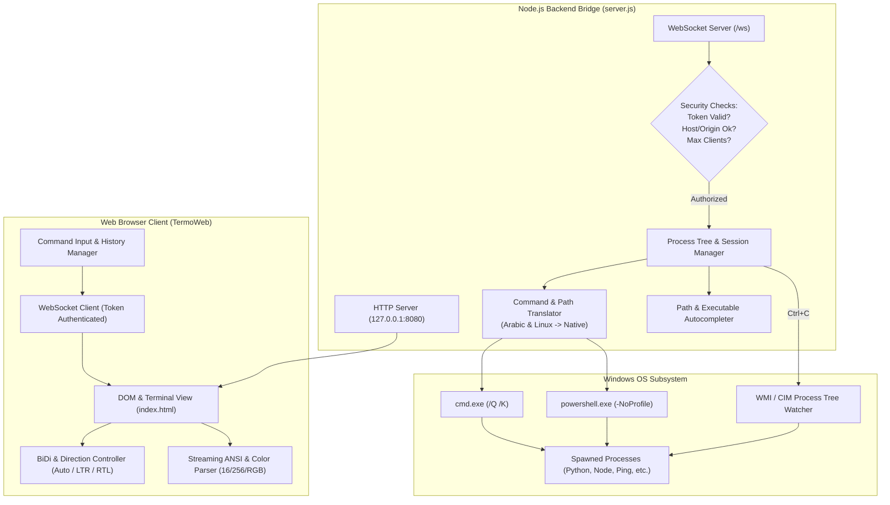

# TermoWeb ⚡

<p align="center">
  <strong>A modern, secure, and bidirectional web-based Windows terminal bridging CMD & PowerShell to your browser.</strong>
  <br />
  <em>Features native Arabic BiDi / RTL support, transparent Linux command aliases, real-time tab autocompletion, ANSI color themes, and process tree interruption.</em>
</p>

<p align="center">
  
  =18" />
  
  
  
  
</p>

---

## 📖 Overview

Standard Windows console interfaces (`conhost`, Windows Terminal) often struggle with mixed Arabic and English text rendering, reversed brackets, misplaced punctuation, or counter-intuitive editing in bidirectional environments. Furthermore, developers accustomed to Unix environments frequently encounter muscle-memory friction when executing commands on Windows systems.

**TermoWeb** solves both problems. It provides a zero-latency, web-based terminal that executes real native Windows shells (`cmd.exe` or `powershell.exe`) through a hardened local WebSocket bridge. It features intelligent bidirectional (`unicode-bidi`) text isolation, full Arabic command aliases, Unix-to-Windows command mapping, multi-source tab completion, and customizable ANSI color palettes.

---

## ✨ Key Features

### 🌐 Native Arabic RTL & BiDi Typography
- **BiDi Engine**: Uses `unicode-bidi: plaintext` and isolated LTR prompt anchors so that file paths, drive letters, and prompt labels remain strictly left-aligned while Arabic output and input flows naturally right-to-left.
- **Font Pairing**: Integrates [Cairo](https://fonts.google.com/specimen/Cairo) for smooth Arabic typography alongside [Cascadia Code](https://github.com/microsoft/cascadia-code) for monospaced code and paths.
- **Arabic Normalization**: Transparently strips diacritics (tashkeel / harakat), tatweel, and normalizes character variants (e.g., `أ` / `إ` / `آ` $\rightarrow$ `ا`, `ى` $\rightarrow$ `ي`).
- **IME-Safe Input**: Ignores intermediate keystrokes during active Arabic or multi-byte IME composition, avoiding premature command submission.

### 🐧 Unix / Linux Muscle Memory on Windows
- **Transparent Translation**: Write familiar Unix commands without installing WSL, Cygwin, or Git Bash. The backend automatically translates commands and flags before passing them to the active Windows shell:
  - `ls -la` $\rightarrow$ `dir /a` (CMD) or `Get-ChildItem -Force` (PowerShell)
  - `rm -rf ./folder` $\rightarrow$ `rmdir /s /q .\folder` (CMD) or `Remove-Item -Recurse -Force` (PowerShell)
  - `grep -in "pattern"` $\rightarrow$ `findstr /i /n "pattern"` (CMD) or `Select-String` (PowerShell)
- **Automatic Path Normalization**: Automatically converts POSIX forward slashes (`./src/app.js`) to Windows backslashes (`.\src\app.js`) while preserving URLs and command switches.
- **Pipeline Support**: Segments chained via pipes (e.g. `dir | grep test`) have each pipeline stage individually analyzed and translated.

### ⚡ Intelligent Multi-Source Tab Autocompletion
- **Command Completion**: Autocompletes built-in Windows commands, PowerShell cmdlets, Linux aliases, Arabic aliases, and any executable found within the system `PATH` (cached for snappy performance).
- **Filesystem & Path Completion**: Quote-aware filename completion that handles spaces, special characters, directory traversal, and tilde home directory expansion (`~`).
- **Interactive Suggestions**: Shows a visual suggestion matrix when multiple matches exist; press `Tab` or `Shift+Tab` to cycle through choices.

### 🛑 True Process Tree Interrupt (Ctrl+C)
- In piped terminal servers, sending a raw signal often kills the parent shell rather than the running task.
- TermoWeb queries the active Windows process tree via WMI / PowerShell CIM (`Get-CimInstance Win32_Process`) and dispatches a targeted `taskkill /PID ... /T /F` to child executables (Python scripts, Node workers, `ping`, long builds) while keeping the host shell active.

### 🎨 ANSI Streaming Parser & Color Themes
- **ANSI Terminal Emulation**: Full streaming escape sequence parser supporting 16 standard ANSI colors, 256 indexed colors, 24-bit TrueColor RGB (`38;2;r;g;b`), bold, dim, italic, underline, and inverted styles.
- **Dynamic Progress Updates**: Supports carriage return (`\r`) parsing for CLI downloaders, spinners, and progress meters.
- **Color Themes**:
  - `Classic CMD`: Vintage dark gray console aesthetic.
  - `Matrix Green 0A`: Monochromatic phosphor green on black.
  - `Blue PowerShell`: Classic Windows PowerShell deep blue console.
  - `Ubuntu Dark`: Aubergine / purple Linux terminal theme.
- **State Persistence**: Theme, shell, text direction, and command history (last 300 entries) are saved in `localStorage`.

### 🛡️ Enterprise-Grade Localhost Security
- **Strict Loopback Binding**: Binds exclusively to `127.0.0.1`, ignoring external network interfaces.
- **Cryptographic Per-Session Tokens**: Generates a 192-bit cryptographic random hex token (`crypto.randomBytes(24)`) on server start. WebSocket handshakes require this token and are validated using constant-time comparison (`crypto.timingSafeEqual`) to eliminate timing attacks.
- **Anti-Hijacking Guards**: Verifies both HTTP `Host` and `Origin` headers to prevent Cross-Site WebSocket Hijacking (CSWSH) and DNS-rebinding attacks from malicious websites.
- **Hardened HTTP Headers**: Strict `Content-Security-Policy` (CSP), `X-Frame-Options: DENY`, `X-Content-Type-Options: nosniff`, and `Referrer-Policy: no-referrer`.
- **Session Throttling**: Caps maximum concurrent connections to 8 sessions to protect system resources.

---

## 🏛️ Architecture



---

## 🚀 Quick Start

### Prerequisites
- **Operating System**: Windows 10, Windows 11, or Windows Server (x64 / ARM64).
- **Runtime**: [Node.js](https://nodejs.org/) v18.0.0 or higher.

### Option 1: One-Click Startup (Recommended)
Double-click `start.bat` in the repository root.
- Automatically checks if Node.js is installed (and opens download page if missing).
- Installs dependencies automatically on first launch (`npm install`).
- Boots the server and launches your default browser at `http://127.0.0.1:8080`.

### Option 2: Manual Setup via Command Line

1. **Clone the repository**:
   ```cmd
   git clone https://github.com/Ahmeddouhm/TermoWeb.git
   cd TermoWeb
   ```

2. **Install dependencies**:
   ```cmd
   npm install
   ```

3. **Start the server**:
   ```cmd
   npm start
   ```
   *To start and automatically launch the browser window:*
   ```cmd
   npm run open
   ```

4. **Open your browser**:
   Navigate to [http://127.0.0.1:8080](http://127.0.0.1:8080).

---

## ⚙️ Configuration & Options

### Custom Port
By default, the server listens on port `8080`. You can customize the port using the `PORT` environment variable:

```cmd
:: Windows CMD
set PORT=3000 && npm start

:: Windows PowerShell
$env:PORT="3000"; npm start
```

### Command Line Flags
| Flag | Description |
| :--- | :--- |
| `--open` | Automatically launches the default web browser upon server startup. |

---

## ⌨️ Keyboard Shortcuts & Controls

| Shortcut / Control | Action | Description |
| :--- | :--- | :--- |
| <kbd>Enter</kbd> | **Execute** | Submits the active command line to the running shell. |
| <kbd>Tab</kbd> | **Autocomplete** | Completes command names or file paths. If multiple matches exist, displays suggestions. |
| <kbd>Tab</kbd> / <kbd>Shift</kbd>+<kbd>Tab</kbd> | **Cycle Suggestions** | Cycles forward / backward through the active suggestion list. |
| <kbd>↑</kbd> / <kbd>↓</kbd> | **History Navigation** | Recalls previous / next commands from command history (stored in `localStorage`). |
| <kbd>Ctrl</kbd> + <kbd>C</kbd> | **Interrupt** | Terminates running child process trees without closing the shell (or discards current input if idle). Normal copy is preserved if text is selected. |
| <kbd>Ctrl</kbd> + <kbd>L</kbd> | **Clear Buffer** | Clears the on-screen terminal scrollback buffer. |
| *Any character key* | **Quick Focus** | Pressing any alphanumeric key automatically refocuses the terminal input field. |
| **Kill Button** | **Interrupt Process** | UI toolbar shortcut for <kbd>Ctrl</kbd> + <kbd>C</kbd>. |
| **Clear Button** | **Clear Screen** | UI toolbar shortcut for <kbd>Ctrl</kbd> + <kbd>L</kbd>. |
| **Reconnect Button**| **Restart Session** | Re-establishes WebSocket connection and launches a fresh shell session. |

---

## 📚 Command Aliases Reference

### 1. Arabic Command Aliases
Type natural Arabic words directly into the console. TermoWeb translates them in real-time:

| Arabic Command | Canonical | Translated to (CMD) | Translated to (PowerShell) | Purpose |
| :--- | :--- | :--- | :--- | :--- |
| `ملفات` | `ls` | `dir` | `Get-ChildItem` | List files and folders |
| `مسح` | `clear` | `cls` | `cls` | Clear the terminal screen |
| `ادخل <مسار>` | `cd` | `cd <path>` | `Set-Location <path>` | Change working directory |
| `اقرا <ملف>` | `cat` | `type <file>` | `Get-Content <file>` | Display file contents |
| `انشئ <مجلد>` | `mkdir` | `mkdir <dir>` | `New-Item -ItemType Directory` | Create new directory |
| `احذف <هدف>` | `rm` | `del /q` or `rmdir /s /q` | `Remove-Item` | Remove file or folder |
| `انسخ <مصدر>` | `cp` | `copy /y` or `xcopy /e /i`| `Copy-Item` | Copy file or directory |
| `انقل <مصدر>` | `mv` | `move /y` | `Move-Item` | Move or rename file/folder |
| `شجرة` | `tree` | `tree` | `tree` | Display folder hierarchy |
| `مكاني` | `pwd` | `cd` | `Get-Location` | Print current directory |
| `خروج` | `exit` | `exit` | `exit` | Terminate session |

> [!NOTE]
> Arabic text is normalized automatically: diacritics (tashkeel), tatweel (`ـ`), and letter variants (`أ`,`إ`,`آ` $\rightarrow$ `ا`) are handled seamlessly.

### 2. Unix / Linux Aliases on Windows
TermoWeb translates standard Linux commands and flags on the fly:

| Linux Command | Supported Flags | Translation in CMD | Translation in PowerShell |
| :--- | :--- | :--- | :--- |
| `ls` / `ll` | `-a`, `-R`, `-t`, `-S`, `-1` | `dir [/a] [/s] [/o-d] [/o-s] [/b]` | `Get-ChildItem [-Force] [-Recurse]` |
| `pwd` | — | `cd` | `Get-Location` |
| `cat` | — | `type <files>` | `Get-Content <files>` |
| `clear` | — | `cls` | `Clear-Host` |
| `rm` | `-r`, `-R`, `-f` | `del /q [/f]` or `rmdir /s /q` | `Remove-Item [-Recurse] [-Force]` |
| `cp` | `-r`, `-R` | `copy /y` or `xcopy /e /i /y` | `Copy-Item [-Recurse]` |
| `mv` | — | `move /y` | `Move-Item` |
| `mkdir` | — | `mkdir` | `New-Item -ItemType Directory` |
| `grep` | `-i`, `-n`, `-v`, `-r` | `findstr [/i] [/n] [/v] [/s]` | `Select-String` |
| `which` | — | `where` | `Get-Command` |
| `touch` | — | `type nul >> <file>` | Creates file or updates timestamp |
| `man` | — | `help` | `Get-Help` |

---

## 🔒 Security Architecture

Running a web terminal that bridges to a real operating system shell demands rigorous security precautions. TermoWeb implements defensive layers to protect your local machine:

1. **Loopback-Only Binding**:
   - The HTTP and WebSocket servers listen exclusively on `127.0.0.1`. They are unreachable from other machines on your local network.

2. **Cryptographic Random Session Token**:
   - Every time `server.js` boots, it generates a fresh 192-bit cryptographic token (`crypto.randomBytes(24)`).
   - This token is injected directly into `index.html` at request time.
   - Any WebSocket connection attempt without a valid token parameter (`?token=...`) is rejected with code `1008 (Policy Violation)`.
   - Token checks utilize `crypto.timingSafeEqual()` to guard against side-channel timing attacks.

3. **Cross-Site WebSocket Hijacking (CSWSH) & DNS Rebinding Protection**:
   - Both the HTTP server and the WebSocket upgrade handler inspect the `Host` and `Origin` headers.
   - Requests with unexpected `Host` headers or foreign `Origin` domains (e.g. if a malicious website attempts to query `http://127.0.0.1:8080/ws` via JavaScript) are blocked with `403 Forbidden`.

4. **Defense-in-Depth HTTP Headers**:
   ```http
   Content-Security-Policy: default-src 'none'; script-src 'unsafe-inline'; style-src 'unsafe-inline' https://fonts.googleapis.com; font-src https://fonts.gstatic.com; connect-src ws://127.0.0.1:8080 ws://localhost:8080; img-src data:; base-uri 'none'; form-action 'none'; frame-ancestors 'none';
   X-Content-Type-Options: nosniff
   X-Frame-Options: DENY
   Referrer-Policy: no-referrer
   ```

5. **Client Throttling**:
   - Caps concurrent active sessions at 8 connections (`MAX_CLIENTS`), rejecting excess connections with code `1013`.

---

## 📁 Repository Structure

```text
web-terminal/
├── index.html            # Frontend terminal client (UI, BiDi styling, ANSI parser, autocomplete)
├── server.js             # Node.js backend (WebSocket bridge, alias translator, security layer)
├── package.json          # Node package manifest, scripts, and dependency definitions
├── package-lock.json     # Locked dependency tree
├── start.bat             # Windows one-click startup script (auto-installs dependencies)
└── README.md             # Project documentation
```

---

## 🛠️ Troubleshooting & FAQ

#### Q: The browser displays "Session token is no longer valid".
**A:** This occurs when the `node server.js` process is restarted while your browser tab remains open. Because a new cryptographic session token is generated on each server start, simply click the **Reconnect** button in the header (or refresh the page) to reload the fresh token.

#### Q: "Port 8080 is already in use".
**A:** Another process on your machine is utilizing port 8080. Start TermoWeb on an alternate port:
```cmd
set PORT=8085 && npm start
```

#### Q: Can I run TermoWeb on Linux or macOS?
**A:** TermoWeb is specifically engineered for Windows environments to bridge `cmd.exe` and `powershell.exe`, handle Windows path conventions (`C:\...`), and manage Windows process trees (`taskkill` / `Win32_Process`). Running it on non-Windows platforms will gracefully exit with an informative error message.

#### Q: How does Ctrl+C distinguish between interrupting a program and copying text?
**A:** If you have selected text on the terminal screen, <kbd>Ctrl</kbd> + <kbd>C</kbd> performs a standard clipboard copy. If no text is selected, it dispatches an interrupt signal to running child processes.

---

## 🤝 Contributing

Contributions, bug reports, and suggestions are welcome!
1. Fork the repository (`https://github.com/Ahmeddouhm/TermoWeb`).
2. Create a feature branch (`git checkout -b feature/amazing-feature`).
3. Commit your changes (`git commit -m "Add amazing feature"`).
4. Push to the branch (`git push origin feature/amazing-feature`).
5. Open a Pull Request.

---

## 📄 License

This project is licensed under the [MIT License](https://opensource.org/licenses/MIT).

<p align="center">
  Crafted with ❤️ by <a href="https://github.com/Ahmeddouhm">Ahmed Douha</a>
</p>

